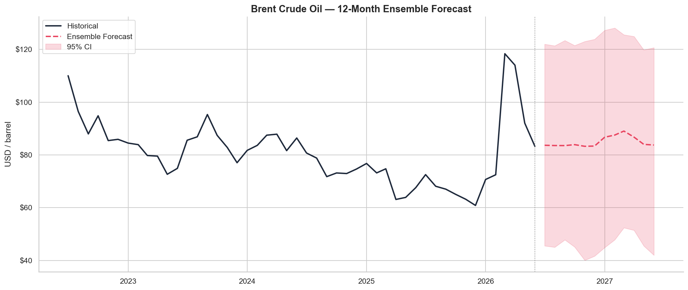
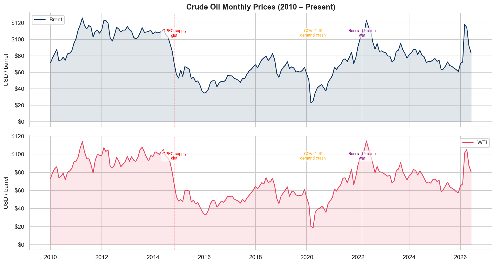
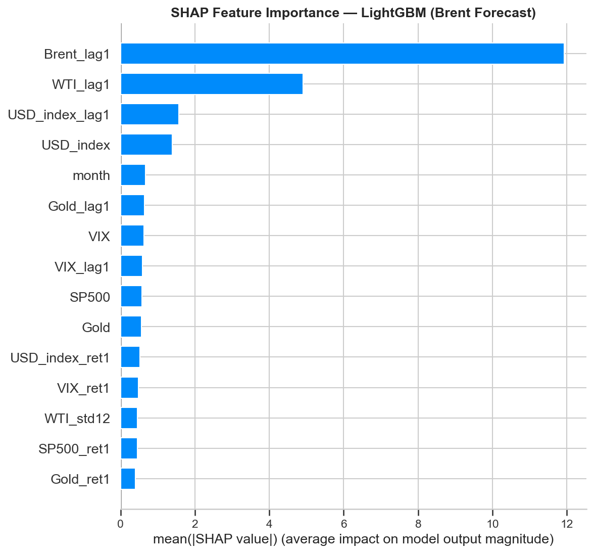
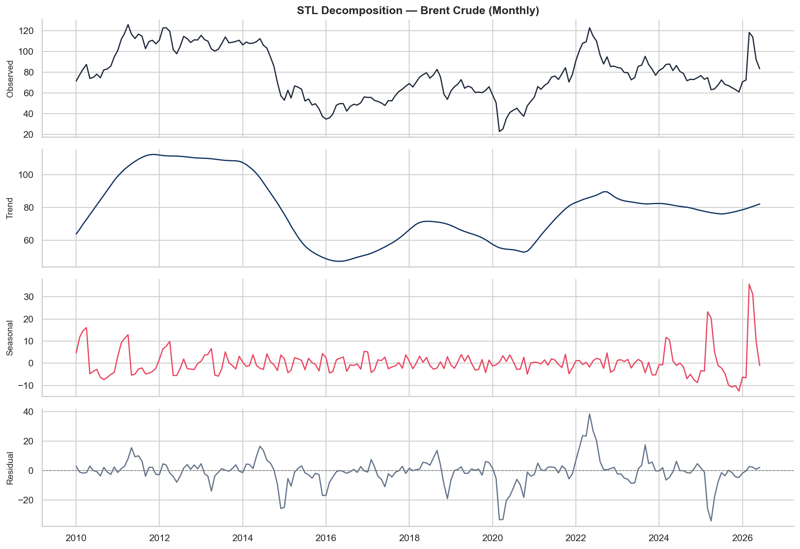
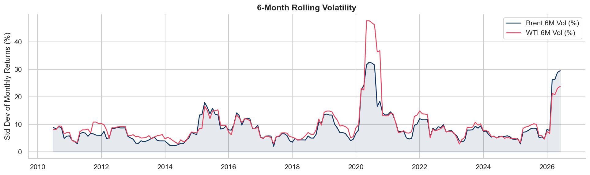

# 🛢️ Crude Oil Price Forecasting — Brent & WTI


> A production-ready machine learning pipeline that forecasts monthly **Brent and WTI crude oil prices** 12 months into the future, combining classical time-series models with gradient-boosted trees and macroeconomic features. Built as part of a personal portfolio for energy economics research.

**Author:** Vu Xuan Duy Anh | NEU-DSEB Year 2 | [GitHub](https://github.com/duyanhvuxuan25052006-lgtm)

---

## 🏆 Key Results

| Model | Mean MAE (USD/barrel) | Mean MAPE | Notes |
|---|---|---|---|
| **LightGBM** | **7.45** | **11.71%** | 🥇 Best model |
| XGBoost | 9.99 | 15.03% | Strong with macro features |
| SARIMA | 9.96 | 15.57% | Stable baseline |
| Ensemble | 11.25 | 17.20% | Weighted blend |
| Prophet | 22.88 | 35.59% | Weakened by COVID structural break |

**12-Month Forecast (Jul 2026 – Jun 2027):** Brent estimated at **$83–89/barrel**

*Evaluated via 5-fold walk-forward cross-validation (horizon = 6 months)*

### 📈 Final Ensemble Forecast


---

## 🗂️ Project Structure

```
oil_forecast/
├── pipeline.py                        # Main script — full pipeline end-to-end
├── oil_price_forecasting.ipynb        # Jupyter notebook with step-by-step explanations
├── requirements.txt                   # Python dependencies
├── README.md
└── output/
    ├── fig1_price_history.png         # Brent & WTI price history with event annotations
    ├── fig2_stl_decomposition.png     # STL decomposition (Trend / Seasonal / Residual)
    ├── fig3_rolling_volatility.png    # 6-month rolling volatility
    ├── fig4_monthly_seasonality.png   # Box plot by month
    ├── fig5_shap_importance.png       # SHAP feature importance (top 15)
    ├── fig6_forecast.png              # 12-month forecast with CI bands
    ├── forecast_interactive.html      # 🌐 Interactive Plotly chart (open in browser)
    ├── forecast_output.csv            # Forecast values + confidence intervals
    ├── cv_results.csv                 # Per-fold CV metrics
    └── cv_summary.csv                 # Aggregated CV summary
```

---

## ⚙️ Pipeline Overview

```
Raw Data (Yahoo Finance + Macro)
        │
        ▼
  Data Ingestion
  ├── Brent (BZ=F) & WTI (CL=F) — daily → resample monthly
  └── Macro: USD Index, S&P 500, Gold, VIX
        │
        ▼
  Exploratory Data Analysis
  ├── Price history + event annotations (OPEC, COVID, Russia-Ukraine)
  ├── STL decomposition (Trend / Seasonal / Residual)
  ├── Rolling volatility
  ├── Monthly seasonality box plot
  └── Correlation heatmap (oil vs macro)
        │
        ▼
  Stationarity Test (ADF)
  └── Brent & WTI are I(1) → differencing required for SARIMA
        │
        ▼
  Feature Engineering (60+ features)
  ├── Lag features     : lag1, lag2, lag3, lag6, lag12
  ├── Rolling stats    : MA(3,6,12), Std(3,6)
  ├── Momentum         : 1M / 3M / 12M returns
  ├── Calendar         : month_sin/cos, quarter_sin/cos, regime dummies
  └── Macro            : USD_index, SP500, Gold, VIX + their lags & returns
        │
        ▼
  Walk-Forward Cross-Validation (5 folds, horizon=6)
  ├── SARIMA(1,1,1)(1,1,0,12)
  ├── Prophet (multiplicative seasonality)
  ├── XGBoost
  └── LightGBM ← best
        │
        ▼
  Final Training on Full History
  └── Weighted Ensemble: LGB(50%) + XGB(30%) + Prophet(20%)
        │
        ▼
  SHAP Explainability
  └── Top 15 features by mean |SHAP value|
        │
        ▼
  12-Month Forecast + Confidence Intervals
  └── Static PNG + Interactive Plotly HTML
```

---

## 🚀 Installation & Usage

### 1. Clone repository
```bash
git clone https://github.com/duyanhvuxuan25052006-lgtm/crude-oil-forecasting.git
cd crude-oil-forecasting
```

### 2. Install dependencies
```bash
pip install -r requirements.txt
```

### 3. Run full pipeline
```bash
python pipeline.py
```
*Downloads data automatically. Outputs saved to `./output/`.*

### 4. Or explore the Notebook
```bash
jupyter notebook oil_price_forecasting.ipynb
```

---

## 🔬 Key Findings & Insights

### 1. Oil Price History & Major Shock Events
Historical Brent and WTI crude oil prices show distinct volatility regimes driven by geopolitical and macroeconomic shocks.



### 2. Non-stationarity (ADF Test)
Brent and WTI are both **I(1)** — integrated of order 1. The level series has unit root (p > 0.05), but first-differenced series is stationary (p < 0.0001). This confirms SARIMA requires `d=1`.

### 3. Why Prophet underperforms
Prophet assumes **piecewise linear trend** and extrapolates it forward. The COVID-19 shock in April 2020 (negative oil prices) created a structural break that Prophet cannot recover from — it overfits the pre-2020 trend and overestimates post-2020 prices. LightGBM with lag features adapts better to the new regime.

### 4. SHAP: What drives oil price forecasts?
The top predictive features are:
- **Brent_lag1, Brent_lag3** — strong autocorrelation in monthly prices
- **Brent_ma6, Brent_ma12** — medium-term momentum
- **USD_index_lag1** — dollar strengthening pushes oil down (inverse correlation ~-0.5)
- **month_sin/cos** — seasonal patterns (Q1 typically higher demand due to heating)



### 5. Volatility Regimes & STL Decomposition
Rolling 6-month volatility spikes clearly at: 2014-11 (OPEC supply decision), 2020-04 (COVID demand collapse), 2022-03 (Russia-Ukraine). These correspond to the largest residuals in STL decomposition.




---

## 📦 Output Files

| File | Description |
|---|---|
| `forecast_interactive.html` | 🌐 Open in browser — interactive multi-model forecast chart |
| `fig1_price_history.png` | Historical prices with key event annotations |
| `fig2_stl_decomposition.png` | STL: Trend, Seasonal, Residual components |
| `fig5_shap_importance.png` | SHAP bar chart — top 15 features |
| `forecast_output.csv` | 12-month Ensemble forecast + 95% CI |
| `cv_results.csv` | Per-fold MAE/MAPE for all models |

---

## 🔮 Future Work

- [ ] Add OPEC+ monthly production data (EIA API)
- [ ] Geopolitical Risk Index (GPR) as feature
- [ ] LSTM / Temporal Fusion Transformer for long-range dependencies
- [ ] Bayesian structural time series for better uncertainty quantification
- [ ] Real-time dashboard with Streamlit

---

## 📄 License

MIT License — free to use, modify, and distribute.

---

*Built with ❤️ by Vu Xuan Duy Anh — NEU Data Science for Economics & Business (DSEB)*
